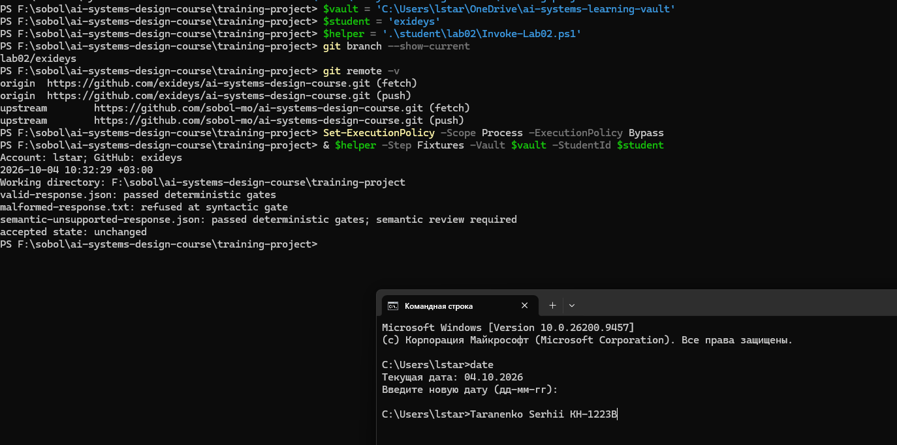
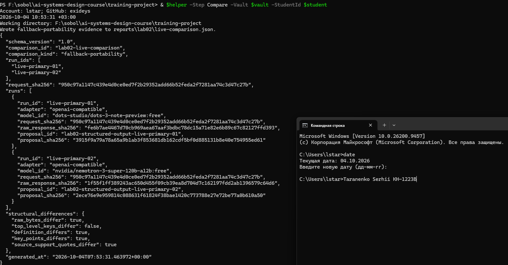
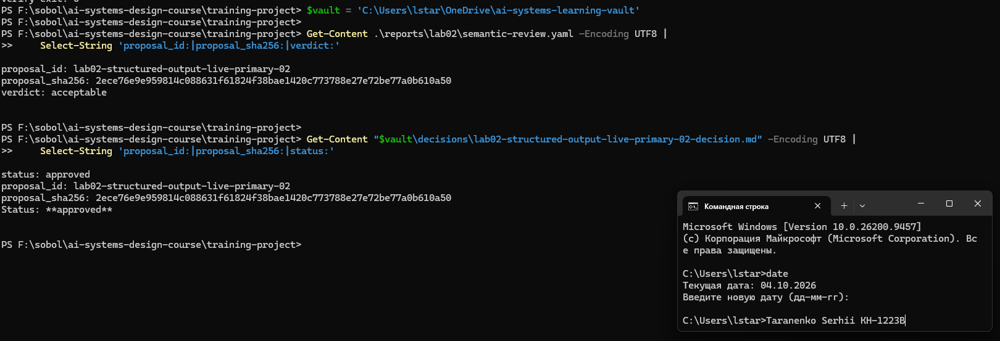
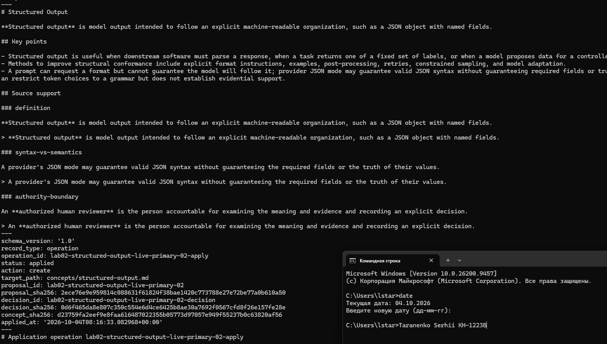
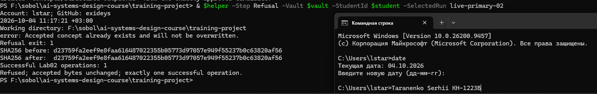
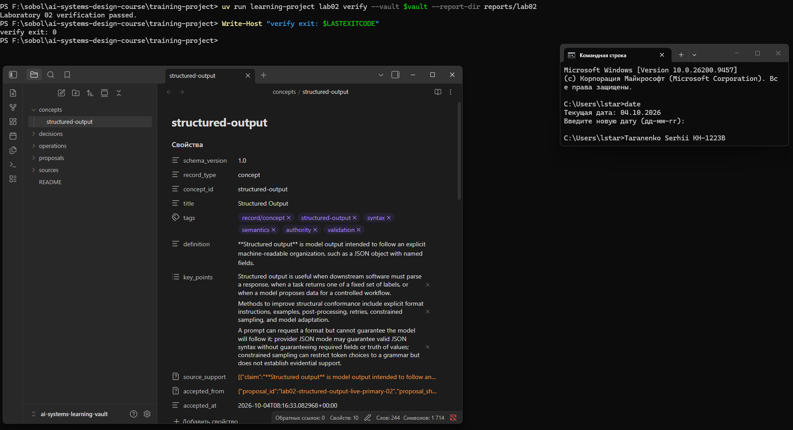

# Лабораторна робота 02

У роботі студент отримав дві структуровані відповіді через OpenRouter, порівняв їх і обрав другого кандидата. Після розгляду та схвалення студент застосував його до сховища. Повторне застосування було відхилене, а прийняте поняття залишилося незмінним.

## Ідентифікація подання

- Автор: Taranenko Serhii, група KH-1223B.
- Дата виконання: 03–04.10.2026.
- Акаунт Windows: `lstar`; GitHub: `exideys`.
- URL форку: https://github.com/exideys/ai-systems-design-course
- Особиста гілка: `lab02/exideys`.
- Повний хеш коміту зі свідченнями: `b52f7bb19f88a1f2660a015a37dd88a1ea2fee9a`.

## Початковий стан і реєстрація джерела

Для роботи використано Windows, PowerShell і наявне сховище Lab01: `C:\Users\lstar\OneDrive\ai-systems-learning-vault`. Перед початком у ньому ще не було прийнятого поняття Structured Output. Гілку `lab02/exideys` оновлено з `upstream/main` зі збереженням результатів Lab01. Файли CLI, схеми й публічні тести вручну не змінювалися.

Через CLI зареєстровано повний §1.3 англомовної теорії. Запис джерела — `sources/module-02-foundation-models-and-ai-application-architecture.md`, фрагмент — `module-02-1-3-structured-output-controls-v1`. Його `course_commit` — `d537707c258858562f811003a50cb6aca8f0fcd1`, а SHA-256 фрагмента — `7d7d5ce2d33d4852985c2337292fbf257ae554cefbbf7e4b9e4ef8090a797063`. Ця прив’язка залишилася незмінною після оформлення звіту.

## Детерміновані шлюзи

Студент запустив перевірку фікстур із каталогу `training-project`:

```powershell
uv run learning-project lab02 check-fixtures --vault $vault
```

```text
valid-response.json: passed deterministic gates
malformed-response.txt: refused at syntactic gate
semantic-unsupported-response.json: passed deterministic gates; semantic review required
accepted state: unchanged
```

Коректна відповідь пройшла перевірку, а пошкоджена була відхилена під час парсингу. Семантично непридатна відповідь пройшла автоматичні шлюзи, але потребувала розгляду людиною. Отже, правильна структура ще не означає правильного змісту. Прийнятий стан під час цих перевірок не змінився.



Рисунок — `01-offline-gates.png`: результати перевірки трьох фікстур.

## Живі запуски та порівняння

Студент виконав два живі запуски через OpenRouter з адаптером `openai-compatible`. Запити містили той самий фрагмент джерела й вимоги `source_only: true`, `exact_quotes: true`, `external_knowledge_allowed: false`. Обидва файли `model-request.json` мають SHA-256 `950c97a1147c439e4d0ce0ed7f2b29352add66b52feda2f7281aa74c3d47c27b`.

| Запуск | Модель | Синтаксис | Інваріанти |
|---|---|---|---|
| `live-primary-01` | `dots-studio/dots-3-note-preview:free` | passed | failed |
| `live-primary-02` | `nvidia/nemotron-3-super-120b-a12b:free` | passed | passed |

Перший кандидат прибрав маркери `**` із цитат категорій `definition` та `authority-boundary`. Через це цитати перестали бути точними підрядками джерела. Другий кандидат зберіг маркери та пройшов валідацію. Студент обрав саме його; невдалий перший запуск також залишився у свідченнях.

У `live-comparison.json` порівняння визначене як `fallback-portability`, оскільки моделі різні, хоча адаптер однаковий. Відрізняються сирі відповіді, визначення, ключові пункти й цитати; набір верхніх полів однаковий. Ці відмінності не можна пояснювати лише випадковістю генерації, адже змінилася також модель.



Рисунок — `03-live-comparison.png`: моделі, результати валідації та порівняння.

## Семантична коректність і повноваження

Синтаксичний шлюз перевіряє, чи можна розібрати відповідь. Шлюз інваріантів перевіряє поля, ідентифікатори, категорії підтримки та дослівність цитат. Семантичний розгляд потрібен, щоб оцінити значення тверджень і відповідність джерелу.

Схема постачальника або успішний `validate` не доводять правдивості кандидата. Модель пропонує дані, CLI перевіряє структуру, а рішення про прийнятність ухвалює людина. Студент записав розгляд і схвалення; лише після цього окрема команда `apply` створила прийнятий запис.

## Семантичний розгляд і рішення

Студент розглянув `lab02-structured-output-live-primary-02` і заповнив відповіді на шість запитань. У `semantic-review.yaml` збережено `reviewed_by: exideys` та `verdict: acceptable`.

1. Визначення відповідає джерелу: Structured Output задає машинозчитувану організацію відповіді, наприклад JSON з іменованими полями. Це не гарантія істинності значень.
2. Три різні дослівні цитати підтримують визначення, відмінність синтаксису від семантики та повноваження рецензента.
3. Кандидат не прирівнює правильний синтаксис до правильного змісту. Він не перелічує всі три шлюзи в `key_points`; цей поділ уточнений у розгляді за джерелом.
4. Змістовне рішення належить людині. Кандидат не описує окремий `apply`; його роль визначена джерелом і реалізована CLI. Це обмеження повноти кандидата.
5. Непідтриманих зовнішніх фактів або гарантій істинності не виявлено.
6. Теги й ключові пункти придатні для навчання та не містять метаданих постачальника.

З урахуванням цих обмежень студент схвалив кандидата. Рішення `lab02-structured-output-live-primary-02-decision` має `status: approved` і `recorded_by: exideys`. Воно прив’язане до конкретних байтів пропозиції, валідації та розгляду.



Рисунок — `04-review-decision.png`: рішення `approved`, обґрунтування `acceptable` і прив’язки SHA-256. Повні відповіді збережені в `semantic-review.yaml`.

## Прив’язки SHA-256

Запис джерела зв’язує теорію, коміт і фрагмент. Метадані запуску зв’язують запит та сиру відповідь; пропозиція — джерело й отриманого кандидата. Валідація зв’язана з пропозицією, розгляд — із пропозицією та валідацією, рішення — з усіма трьома. Поле `accepted_from` і запис операції пов’язують прийняте поняття зі схваленим кандидатом.

Такі хеші допомагають виявити зміну байтів у ланцюгу. Вони не доводять правильності змісту, авторства пояснень або походження відповіді від зовнішньої моделі.

| Артефакт або прив'язка | SHA-256 |
|---|---|
| Зареєстрований запис джерела | c25ece79b5c7530dfb1d3836a2d6f0b07e0fd31c538ed81a9b0a48be1f4478c8 |
| Фрагмент §1.3 | 7d7d5ce2d33d4852985c2337292fbf257ae554cefbbf7e4b9e4ef8090a797063 |
| Спільний model-request.json | 950c97a1147c439e4d0ce0ed7f2b29352add66b52feda2f7281aa74c3d47c27b |
| Сира відповідь live-primary-02 | 1f55f1ff389243ac650d455f09cb39ea8d704d7c162197fdd2ab1396579c64d6 |
| Пропозиція live-primary-02 | 2ece76e9e959814c088631f61824f38bae1420c773788e27e72be77a0b610a50 |
| validation-result.json обраного кандидата | 0602b1dbcb27efe7185417c07872a7d4a45e24a341ad77d1e712d2eee35a3e7d |
| semantic-review.yaml | 3c122d65f1aa7a51e509b337190cb72524e489d0d980e0b59d48bf9a0de75ff6 |
| Рішення live-primary-02-decision.md | 0d6f465da8e807c350c554e6d4ce6425b8ae30a7692f0567cfd8f26e157fe28e |
| Прийняте concepts/structured-output.md | d23759fa2eef9e8faa616487022355b05773d97057e949f55237b0c63820af56 |
| Запис операції live-primary-02-apply.md | a23d45ef72cfd41161b07074ec9af380a8fcc6adbea54fdd676b242af1c5c83a |

## Контрольоване застосування

Після схвалення студент виконав `Apply` для `live-primary-02`. CLI перевірив валідацію, вердикт, рішення та хеші, після чого створив `concepts/structured-output.md` і `operations/lab02-structured-output-live-primary-02-apply.md` у зовнішньому сховищі.

У понятті збережено `concept_id: structured-output` та `accepted_from` з ідентифікаторами й хешами пропозиції та рішення. Запис операції має `status: applied`, `action: create`, `target_path: concepts/structured-output.md`. Успішна операція Lab02 одна.



Рисунок — `05-controlled-apply.png`: прийняте поняття та запис операції.

## Відмова без зміни прийнятого стану

Студент повторив застосування тієї самої пропозиції. CLI відмовив із повідомленням `Accepted concept already exists and will not be overwritten` та кодом виходу `1`.

SHA-256 поняття до й після спроби однаковий: `d23759fa2eef9e8faa616487022355b05773d97057e949f55237b0c63820af56`. Кількість успішних операцій залишилася рівною `1`. Отже, відмова не змінила прийнятого стану.



Рисунок — `02-refusal-unchanged.png`: відмова, однакові хеші та одна успішна операція.

## Проєктний компроміс

Безоплатні моделі зменшують витрати, але можуть давати різні результати й потребують перевірки. Автоматичні шлюзи швидкі та відтворювані, проте оцінюють структуру. Розгляд людиною займає більше часу, зате перевіряє зміст. У двох виконаних запусках зміна моделі дала придатного кандидата без ручного виправлення сирої відповіді. Додаткові виклики лише заради відмінностей не знадобилися.

## Захист облікових і платіжних даних

Ключ OpenRouter студент увів локально через прихований `Read-Host -AsSecureString`. Допоміжний сценарій передавав його через середовище процесу та відновлював попереднє значення після викликів. Ключ не записувався в аргументи команд, звіт або знімки екрана.

Для облікового запису студента в OpenRouter перевірка платіжної картки не була потрібна. Дані картки не вводилися. Зовнішнє сховище й дані автентифікації не включені до подання.

## Канонічний, аудиторський і похідний стан

Канонічне прийняте знання — `concepts/structured-output.md` у зовнішньому сховищі. Сирі відповіді, метадані, пропозиції, валідації, розгляд, рішення та операція збережені як незмінні свідчення.

Порівняння, результат перевірки та Teams-копія звіту є похідними файлами, які можна відбудувати за збереженими входами. Ця копія містить шість вбудованих зображень і не залежить від доступу до папки скриншотів. Вихідний звіт для GitHub залишено з відносними посиланнями на PNG.

## Остаточна перевірка

Студент запустив публічні тести:

```powershell
uv run python -m unittest discover -s tests/public -v
```

Результат: `122` тести, `120` успішних, `1` пропущений і `1` невдалий; підсумок — `FAILED (failures=1, skipped=1)`. Пропуск стосується POSIX Bash на Windows. Невдалий тест `test_agy_profile_extracts_only_the_structured_response_and_records_metadata` вимагає `--sandbox`, хоча адаптер Antigravity на Windows не додає цей флаг. Окремий тест Windows-профілю пройшов. Для живих запусків студент використовував OpenRouter. Повний вихід збережений у `public-tests-student.log`; тести курсу не виправлялися.

Після збереження всіх скриншотів студент виконав фінальну перевірку:

```powershell
uv run learning-project lab02 verify --vault $vault --report-dir reports/lab02
```

Результат — `Laboratory 02 verification passed`, код виходу `0`, усі `10` перевірок успішні. Підсумковий `verification-report.json` перевіряє вихідний звіт, збережені артефакти та PNG. Успішний `verify` підтверджує узгодженість свідчень, але не замінює семантичного розгляду й не означає, що весь набір публічних тестів пройшов.

Студент відкрив прийняте поняття в Obsidian. На фінальному знімку видно його визначення, походження від `live-primary-02`, успішний результат перевірки, акаунт і дату.



Рисунок — `06-final-result.png`: поняття в Obsidian та успішна фінальна перевірка.
