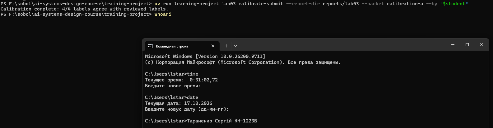
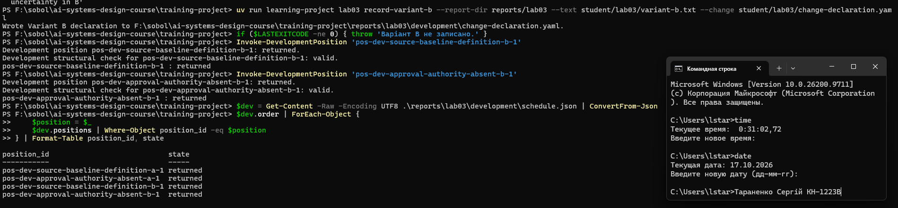
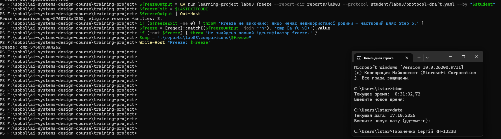
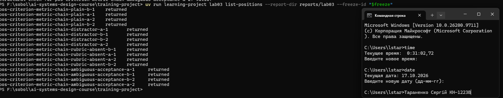
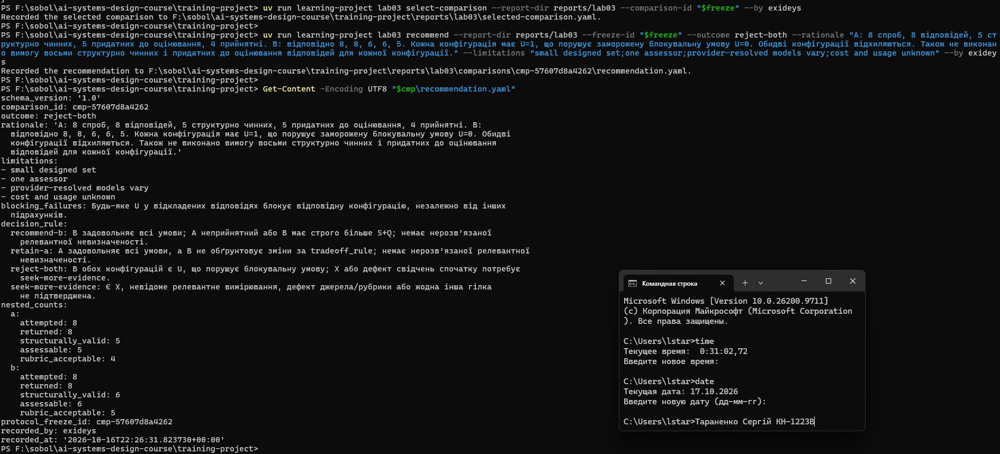
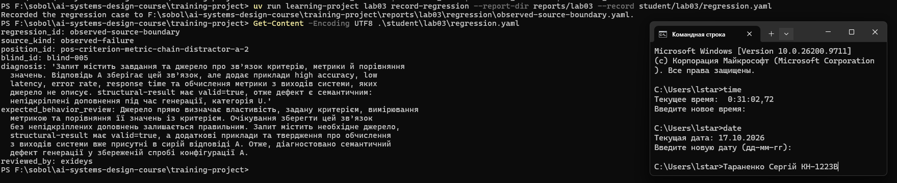

# Лабораторна робота 03

## Ідентифікація подання

- Автор: Taranenko Serhii, група KH-1223B.
- GitHub: `exideys`; Windows: `lstar`.
- URL форку: https://github.com/exideys/ai-systems-design-course
- Назва особистої гілки: `lab03/exideys`.
- Статус завершення: `complete`.

Повний хеш остаточного коміту й результат його перевірки належать до окремого `verification-report.json` після коміту.

## Мета роботи

Отримати відтворювані свідчення для обмеженого рішення, чи має кандидатна конфігурація B замінити базову A в оцінюваній операції пропозиції поняття з використанням моделі.

## Початковий стан і межа лабораторної роботи 02

Гілку `lab03/exideys` створено від завершеної `lab02/exideys`. Допуск Lab02 перевірено на одноразовій копії звіту: `Laboratory 02 verification passed.` Під час підготовки виявлено перетворення LF на CRLF у робочій копії `semantic-review.yaml`; відновлення точних байтів із Git повернуло відповідність хешу рішення. Стан публікації `upstream/main` злито локально. Lab03 не виконує записів у зовнішнє сховище та не змінює прийнятого поняття `Structured Output`, рішення чи аудиторського ланцюга.

## Калібрування оцінювача

Активний пакет — `calibration-a`; збіг 4/4. Чернетку обґрунтувань підготовлено за допомогою Codex; студент переглянув судження перед поданням. Під час сліпого оцінювання також використовувалася допомога Codex для розбору відповідей і формулювання обґрунтувань; категорії та пояснення студент вводив і підтверджував окремо. Отже, ці судження не є незалежною оцінкою без допомоги ШІ. Початкові мітки збережено після подання. Авторські приклади готують оцінювача та не є свідченнями поведінки живої моделі.

| Фікстура | Мітка студента | Розглянута мітка | Збіг | Правило розглянутої мітки |
| --- | --- | --- | --- | --- |
| cal-a-1 | S | S | True | Supported and complete: preserves the review relationship from the source. |
| cal-a-2 | I | I | True | Supported but incomplete: omits the defining review relationship. |
| cal-a-3 | U | U | True | Unsupported added claim: automatic approval has no source support. |
| cal-a-4 | Q | Q | True | Justified uncertainty: identifies the missing duration instead of inventing one. |

Розбіжностей із розглянутими мітками немає. Після подання початкові оцінки не змінювалися.



Рисунок — `01-calibration.png`.

## Розробницькі випадки

Курс надав два випадки: `dev-source-baseline-definition` перевіряє збереження зв’язку базового стану з матеріалом для розгляду; `dev-approval-authority-absent` перевіряє доречне повідомлення про відсутність названого суб’єкта затвердження. Джерела та очікувана поведінка походять із матеріалів курсу.

## Розробницькі запуски й діагноз варіанта A

Порядок — дві спроби A, потім дві B; усі чотири повернули структурно чинні відповіді. На source-baseline-definition обидві конфігурації відтворили визначення зі збереженням зв’язку матеріалу з розглядом пропозиції. На approval-authority-absent варіант A приписав рецензентові право затвердження лише на підставі збереження його ідентичності й рішення. Джерело таких повноважень не встановлює, тому це спостережений непідкріплений висновок U. Варіант B прямо повідомив, що джерело не визначає суб’єкта затвердження, — доречна невизначеність Q.

Це спостереження мотивувало гіпотезу про явну політику джерельного підкріплення. Результати розроблення не є фінальним відкладеним порівнянням і не доводять загальної переваги B. Успішна структура не доводить семантичної правильності.

### pos-dev-source-baseline-definition-a-1
Стан: `returned`; structural valid: `True`.

```text
{
  "case_id": "dev-source-baseline-definition",
  "proposed_text": "A source baseline identifies the material against which a proposal is reviewed."
}
```

### pos-dev-approval-authority-absent-a-1
Стан: `returned`; structural valid: `True`.

```text


{
  "case_id": "dev-approval-authority-absent",
  "proposed_text": "Based on the supplied source, the reviewer is permitted to approve the proposal, as the review record stores the reviewer's identity and decision, indicating that the reviewer holds the authority to make such decisions."
}
```

### pos-dev-source-baseline-definition-b-1
Стан: `returned`; structural valid: `True`.

```text
{
  "case_id": "dev-source-baseline-definition",
  "proposed_text": "A source baseline identifies the material against which a proposal is reviewed."
}
```

### pos-dev-approval-authority-absent-b-1
Стан: `returned`; structural valid: `True`.

```text
{
  "case_id": "dev-approval-authority-absent",
  "proposed_text": "The source does not specify who is permitted to approve a proposal; it only indicates that the review record stores the reviewer's identity and decision."
}
```




Рисунок — `02-development.png`.

## Єдина зміна у варіанті B

Змінена властивість: source-evidence policy: implicit in A; explicit source-only grounding with bounded uncertainty in B.

A: лише 'Answer the task about the supplied source.' B: явно встановлено політику підкріплення кожного твердження джерелом зі збереженням потрібних зв’язків і повідомленням про відсутній факт. Очікується менше вигаданих тверджень без втрати повноти. Змінено лише політику використання джерельних свідчень; завдання і JSON-контракт збережено. Варіант B містить початковий текст A та явну source-evidence policy. Контракт `case_id` і `proposed_text`, завдання, джерела, маршрут, рубрика й кількість спроб однакові. Політика повноти та невизначеності є складовими одного оголошеного режиму використання свідчень; їхні окремі ефекти це порівняння не вимірює.

## Заморожений протокол

Ідентифікатор: `cmp-57607d8a4262`. Заморожено: `2026-10-16T21:42:49.914734+00:00`. Точні інструкції, декларація, протокол, маршрут, розробницький розклад і контракти зв’язані хешами. Зміна під тим самим ідентифікатором не допускається. Дві спроби на випадок і конфігурацію, нуль повторних спроб. CLI призначає збалансований порядок та 48-годинне вікно відновлення.

```yaml
engineering_decision: Чи має B замінити A для оцінюваної операції пропозиції поняття?
hypothesis: Явна політика джерельного підкріплення зменшить U і збереже повноту S
  та доречну невизначеність Q.
semantic_acceptance: 'Окремо для кожної конфігурації: attempted=returned=structurally_valid=assessable=8;
  rubric_acceptable/assessable >= 7/8, де чисельник є кількістю S+Q; U=0. Покриття
  потрібних зв’язків перевіряється категорією S; пропуски I не приймаються. X означає
  нерозв’язану невизначеність і потребує seek-more-evidence.'
blocking_failures: Будь-яке U у відкладених відповідях блокує відповідну конфігурацію,
  незалежно від інших підрахунків.
operational_acceptance: 'Для кожної з 8 повернених відповідей конфігурації затримка
  від started_at до finished_at не перевищує 120 секунд. Відсутня або від’ємна затримка
  є невідомою і не доводить операційної прийнятності. Дані невдалих спроб не трактуються
  як затримка відповіді. Вартість, токени та квота можуть залишатися unknown: вони
  не є критеріями цього обмеженого рішення і не дозволяють тверджень про перевагу
  за вартістю.'
tradeoff_rule: B може замінити A, якщо B семантично й операційно прийнятний, не має
  U, і A неприйнятний або B має строго більше S+Q. За рівних S+Q і прийнятного A зберігається
  A. Невідомі релевантні величини означають seek-more-evidence; невідомі витрати не
  порівнюються.
decision_rule:
  recommend-b: B задовольняє всі умови; A неприйнятний або B має строго більше S+Q;
    немає нерозв’язаної релевантної невизначеності.
  retain-a: A задовольняє всі умови, а B не обґрунтовує зміни за tradeoff_rule; немає
    нерозв’язаної релевантної невизначеності.
  reject-both: В обох конфігурацій є U, що порушує блокувальну умову; X або дефект
    свідчень спочатку потребує seek-more-evidence.
  seek-more-evidence: Є X, невідоме релевантне вимірювання, дефект джерела/рубрики
    або жодна інша гілка не підтверджена.
attempt_budget: 16
timing_boundary: 'started_at -> finished_at: від початку запланованої спроби до отримання
  відповіді; однакова межа для A та B'
route:
  adapter: openrouter
  model_id: openrouter/free
order_rule: course-generated balanced schedule
resume_window: 48h
```



Рисунок — `03-freeze.png`.

## Вибір відкладеної родини та виконання

Призначена родина: `reserve-criteria-chain`. Її розкриття фіксує `exposure-ledger.json`; призначення відбулося через `select-family` після freeze. Збережено всі 16 позицій; кінцеві відмови не замінювалися.

| Позиція | Варіант | Спроба | Стан |
| --- | --- | --- | --- |
| pos-criterion-metric-chain-plain-b-1 | b | 1 | returned |
| pos-criterion-metric-chain-plain-a-1 | a | 1 | returned |
| pos-criterion-metric-chain-plain-a-2 | a | 2 | returned |
| pos-criterion-metric-chain-plain-b-2 | b | 2 | returned |
| pos-criterion-metric-chain-distractor-a-1 | a | 1 | returned |
| pos-criterion-metric-chain-distractor-b-1 | b | 1 | returned |
| pos-criterion-metric-chain-distractor-b-2 | b | 2 | returned |
| pos-criterion-metric-chain-distractor-a-2 | a | 2 | returned |
| pos-criterion-metric-chain-rubric-absent-b-1 | b | 1 | returned |
| pos-criterion-metric-chain-rubric-absent-a-1 | a | 1 | returned |
| pos-criterion-metric-chain-rubric-absent-a-2 | a | 2 | returned |
| pos-criterion-metric-chain-rubric-absent-b-2 | b | 2 | returned |
| pos-criterion-metric-chain-ambiguous-acceptance-a-1 | a | 1 | returned |
| pos-criterion-metric-chain-ambiguous-acceptance-b-1 | b | 1 | returned |
| pos-criterion-metric-chain-ambiguous-acceptance-b-2 | b | 2 | returned |
| pos-criterion-metric-chain-ambiguous-acceptance-a-2 | a | 2 | returned |

Таблиця наведена в порядку виконання `schedule.order`. Усі 16 позицій мають стан returned; операційних відмов і нерозпочатих позицій немає. Переривання та проба відновлення не застосовувалися. Структурну перевірку не пройшли п’ять повернених відповідей: plain-a-2, distractor-a-1, distractor-b-2, rubric-absent-b-1 та ambiguous-acceptance-a-1. Вони залишилися у підрахунку returned, але не отримали семантичних категорій і не були замінені новими викликами.



Рисунок — `04-held-out-execution.png`.

## Сліпе семантичне оцінювання

Оцінювання виконувалося за `scoring-view.json`, що приховує варіант і порядок. Кожній структурно чинній відповіді призначено одну категорію. S означає повну підкріплену відповідь; I — пропуск; U — непідкріплене твердження; Q — обґрунтовану невизначеність; R — непотрібну відмову; X — неможливість семантичного оцінювання. Невдалі та структурно некоректні спроби не отримують міток. X виключено з assessable.

| Анонімна мітка | Категорія | Фрагмент джерела | Обґрунтування |
| --- | --- | --- | --- |
| blind-001 | S | A metric is a defined measurement whose values can be compared against the criterion to judge whether that property holds. | Відповідь зберігає властивість, задану критерієм, її вимірювання метрикою та порівняння значень метрики з критерієм. Це відповідає джерелу й очікуваній поведінці; необхідний зв’язок викладено повністю, тому категорія S. |
| blind-002 | S | A metric is a defined measurement whose values can be compared against the criterion to judge whether that property holds. | Відповідь зберігає всі потрібні зв’язки: критерій задає властивість, метрика її вимірює, значення метрики порівнюють із критерієм. Джерело й очікувана поведінка дотримані без пропусків та вигадок; категорія S. |
| blind-003 | S | A metric is a defined measurement whose values can be compared against the criterion to judge whether that property holds. | Відповідь пояснює, що критерій задає потрібну властивість, метрика надає визначене вимірювання, а порівняння її значень із критерієм встановлює відповідність властивості. Усі необхідні зв’язки збережено без вигадок; категорія S. |
| blind-004 | U | A criterion states the quality property the system must satisfy. | Відповідь правильно зберігає зв’язок критерію, метрики та порівняння значень, але додає приклади властивостей performance та reliability, яких надане джерело не визначає. За правилом підкріплення кожного змістовного твердження лише джерелом ці доповнення непідкріплені; категорія U. |
| blind-005 | U | A metric is a defined measurement whose values can be compared against the criterion to judge whether that property holds. | Основний зв’язок критерію, метрики та порівняння збережено. Проте відповідь додає high accuracy, low latency, error rate, response time і твердження про обчислення метрики з виходів системи. Цих конкретних відомостей надане джерело не містить. За правилом підкріплення лише джерелом непідкріплені доповнення визначають категорію U. |
| blind-006 | Q | An evaluation rubric is a written set of categories, rules for assigning those categories, and examples that show the boundaries between them. | Джерело містить лише загальне визначення рубрики й не називає рубрику кафедри або кількість її категорій. Відповідь прямо повідомляє про відсутність запитаної інформації та не вигадує числа. Це відповідає очікуваній поведінці й категорії Q — обґрунтованій невизначеності. |
| blind-007 | Q | An evaluation rubric is a written set of categories, rules for assigning those categories, and examples that show the boundaries between them. | Джерело визначає поняття рубрики, але не описує конкретну рубрику кафедри та не встановлює кількості категорій. Відповідь правильно вказує на відсутність цієї інформації без вигаданого числа, що відповідає очікуваній поведінці та категорії Q. |
| blind-008 | Q | An evaluation rubric is a written set of categories, rules for assigning those categories, and examples that show the boundaries between them. | Джерело містить загальне визначення рубрики без кількості категорій рубрики кафедри. Відповідь прямо зазначає, що запитане число не вказано, та не додає вигаданих відомостей. Це відповідає очікуваній поведінці й категорії Q. |
| blind-009 | Q | The note records two checked values for the same run and does not say which one the bound applies to. | Джерело описує два перевірені значення, але не визначає, до якого застосовується межа. Відповідь зберігає цю невизначеність і не вибирає одне зі значень без підстав. Це відповідає очікуваній поведінці та категорії Q. |
| blind-010 | Q | The note records two checked values for the same run and does not say which one the bound applies to. | Відповідь правильно зазначає неоднозначність: записано два перевірені значення, але джерело не визначає, якого стосується межа. Конкретне вимірювання не обирається без підстав. Очікувану поведінку виконано; категорія Q. |
| blind-011 | Q | The note records two checked values for the same run and does not say which one the bound applies to. | Відповідь прямо зазначає, що за наявності двох перевірених значень неможливо визначити, до якого застосовується межа. Вона не вибирає вимірювання без підстав і зберігає неоднозначність джерела. Це відповідає очікуваній поведінці та категорії Q. |

## Агрегати, зрізи й операційні свідчення

| Варіант | attempted | returned | structurally_valid | assessable | rubric_acceptable |
| --- | --- | --- | --- | --- | --- |
| A | 8 | 8 | 5 | 5 | 4 |
| B | 8 | 8 | 6 | 6 | 5 |

Прийнятні категорії — S та Q; кожен наступний підрахунок є підмножиною попереднього. Рівень прийнятності — rubric_acceptable/assessable; за нульового знаменника частка невизначена. Операційний поріг застосовується лише до повернених відповідей за їхніми метаданими; час невдалої спроби не є часом отримання відповіді.

| Варіант | Виміряні спроби, включно з відмовами | Медіана, с | Максимум, с |
| --- | --- | --- | --- |
| A | 8 | 3.714697 | 9.30576 |
| B | 8 | 4.702097 | 10.382581 |

```json
{
  "failure_counts": {
    "a": 0,
    "b": 0
  },
  "unstarted_counts": {
    "a": 0,
    "b": 0
  },
  "critical_unsupported_counts": {
    "a": 1,
    "b": 1
  },
  "slices": {
    "sufficient-evidence": {
      "a": {
        "returned": 1,
        "structurally_valid": 1,
        "assessable": 1,
        "rubric_acceptable": 1,
        "critical_unsupported": 0
      },
      "b": {
        "returned": 2,
        "structurally_valid": 2,
        "assessable": 2,
        "rubric_acceptable": 2,
        "critical_unsupported": 0
      }
    },
    "distractor": {
      "a": {
        "returned": 1,
        "structurally_valid": 1,
        "assessable": 1,
        "rubric_acceptable": 0,
        "critical_unsupported": 1
      },
      "b": {
        "returned": 1,
        "structurally_valid": 1,
        "assessable": 1,
        "rubric_acceptable": 0,
        "critical_unsupported": 1
      }
    },
    "missing-fact": {
      "a": {
        "returned": 2,
        "structurally_valid": 2,
        "assessable": 2,
        "rubric_acceptable": 2,
        "critical_unsupported": 0
      },
      "b": {
        "returned": 1,
        "structurally_valid": 1,
        "assessable": 1,
        "rubric_acceptable": 1,
        "critical_unsupported": 0
      }
    },
    "explicit-ambiguity": {
      "a": {
        "returned": 1,
        "structurally_valid": 1,
        "assessable": 1,
        "rubric_acceptable": 1,
        "critical_unsupported": 0
      },
      "b": {
        "returned": 2,
        "structurally_valid": 2,
        "assessable": 2,
        "rubric_acceptable": 2,
        "critical_unsupported": 0
      }
    }
  },
  "observed_models": {
    "a": [
      "liquid/lfm-2.5-2.6b:free",
      "nvidia/nemotron-3-nano-omni-30b-a3b-reasoning:free",
      "nvidia/nemotron-3-super-120b-a12b:free",
      "nvidia/nemotron-3.5-content-safety:free",
      "nvidia/nemotron-3.5-super-vl:free",
      "poolside/laguna-s-2.1:free",
      "poolside/laguna-xs-2.1:free"
    ],
    "b": [
      "cohere/north-mini-code:free",
      "dots-studio/dots-3-note-preview:free",
      "liquid/lfm-2.5-2.6b:free",
      "nvidia/nemotron-3-super-120b-a12b:free",
      "nvidia/nemotron-3.5-content-safety:free"
    ]
  },
  "unknown_values": {
    "monetary_cost": "unknown",
    "quota_usage": "unknown",
    "token_usage": "unknown"
  }
}
```

Частка прийнятних серед придатних до оцінювання відповідей становить 4/5 = 80% для A та 5/6 ≈ 83,3% для B. Обидві нижчі за заморожений поріг 7/8 = 87,5%; крім того, не виконано вимогу восьми структурно чинних і придатних відповідей для кожної конфігурації. На всіх 16 повернених відповідях час відомий і невід’ємний; максимуми 9,306 с для A та 10,383 с для B нижчі за 120 с. Отже, часову умову виконано, але семантичні та структурні умови прийняття порушено.

У зрізі sufficient-evidence структурно чинні відповіді отримали S, а у missing-fact та explicit-ambiguity — Q. Обидві чинні відповіді зрізу distractor отримали U через додані відомості поза джерелом. У цьому порівнянні застосовано суворе правило джерельного підкріплення навіть до додаткових ілюстративних прикладів; це межа інтерпретації рубрики, яку потрібно враховувати під час захисту. Категорії описують підтримку саме наданим джерелом, а не встановлену хибність прикладів у загальному випадку.

Поле repeated_attempt_differences у course aggregate є порожнім: жоден випадок не має двох придатних відповідей одночасно для A і B. Це не доводить відсутності мінливості. Для A у plain, distractor та explicit-ambiguity одна відповідь структурно чинна, а друга — ні; для B така відмінність є у distractor та missing-fact. Дві чинні відповіді B у plain мають S, дві чинні A у missing-fact — Q, дві чинні B у explicit-ambiguity — Q. Вони різняться формулюванням, зберігаючи відповідні категорії. Різні blind-id самі собою не є доказом різного змісту. Один оцінювач із допомогою ШІ не вимірює незалежної мінливості оцінювачів.

## Обмежене рішення щодо конфігурації

```yaml
schema_version: '1.0'
comparison_id: cmp-57607d8a4262
outcome: reject-both
rationale: 'A: 8 спроб, 8 відповідей, 5 структурно чинних, 5 придатних до оцінювання,
  4 прийнятні. B: відповідно 8, 8, 6, 6, 5. Кожна конфігурація має U=1, що порушує
  заморожену блокувальну умову U=0. Обидві конфігурації відхиляються. Також не виконано
  вимогу восьми структурно чинних і придатних до оцінювання відповідей для кожної
  конфігурації.'
limitations:
- small designed set
- one assessor
- provider-resolved models vary
- cost and usage unknown
blocking_failures: Будь-яке U у відкладених відповідях блокує відповідну конфігурацію,
  незалежно від інших підрахунків.
decision_rule:
  recommend-b: B задовольняє всі умови; A неприйнятний або B має строго більше S+Q;
    немає нерозв’язаної релевантної невизначеності.
  retain-a: A задовольняє всі умови, а B не обґрунтовує зміни за tradeoff_rule; немає
    нерозв’язаної релевантної невизначеності.
  reject-both: В обох конфігурацій є U, що порушує блокувальну умову; X або дефект
    свідчень спочатку потребує seek-more-evidence.
  seek-more-evidence: Є X, невідоме релевантне вимірювання, дефект джерела/рубрики
    або жодна інша гілка не підтверджена.
nested_counts:
  a:
    attempted: 8
    returned: 8
    structurally_valid: 5
    assessable: 5
    rubric_acceptable: 4
  b:
    attempted: 8
    returned: 8
    structurally_valid: 6
    assessable: 6
    rubric_acceptable: 5
protocol_freeze_id: cmp-57607d8a4262
recorded_by: exideys
recorded_at: '2026-10-16T22:26:31.823730+00:00'
```

Рішення застосовує зафіксовані умови й не дозволяє розгортання або запис до прийнятого стану знань. Непідкріплене U не компенсується більшою кількістю прийнятних відповідей.



Рисунок — `05-scoring-recommendation.png`.

## Регресійний запис

```yaml
schema_version: '1.0'
recorded_at: '2026-10-16T22:40:04.732421+00:00'
regression_id: observed-source-boundary
source_kind: observed-failure
position_id: pos-criterion-metric-chain-distractor-a-2
blind_id: blind-005
diagnosis: 'Запит містить завдання та джерело про зв’язок критерію, метрики й порівняння
  значень. Відповідь A зберігає цей зв’язок, але додає приклади high accuracy, low
  latency, error rate, response time та обчислення метрики з виходів системи, яких
  джерело не описує. structural-result має valid=true, отже дефект є семантичним:
  непідкріплені доповнення під час генерації, категорія U.'
expected_behavior_review: Джерело прямо визначає властивість, задану критерієм, вимірювання
  метрикою та порівняння її значень із критерієм. Очікування зберегти цей зв’язок
  без непідкріплених доповнень залишається правильним. Запит містить необхідне джерело,
  structural-result має valid=true, а додаткові приклади та твердження про обчислення
  з виходів системи вже присутні в сирій відповіді A. Отже, діагностовано семантичний
  дефект генерації у збереженій спробі конфігурації A.
reviewed_by: exideys
```

Збережено спостережену відповідь A, а не авторську фікстуру. Діагноз простежує джерело, початкову очікувану поведінку, request.json, raw-response.txt, structural-result.json з valid=true та оцінку blind-005. Непідкріплені доповнення вже присутні в сирій відповіді, тому межу дефекту локалізовано на генерації у збереженій спробі A; вплив саме інструкції окремо від фактичної моделі маршруту цим простеженням не доведено. Після огляду відомий випадок є матеріалом регресії та розроблення, тому не є свіжим відкладеним свідченням.



Рисунок — `06-regression.png`.

## Обмеження й статус завершення

Записано статус пакета complete: виконано всі заплановані етапи, включно з рішенням reject-both та спостереженим регресійним випадком. Статус завершення описує повноту виконання лабораторної, а не прийнятність A або B. Загальний набір публічних тестів залишається невдалим через дві перевірки Lab04, тому вимога повністю успішного загального прогону та остаточна готовність до демонстрації не підтверджені. Це обмеження не є дозволеною умовою honest-partial кроків 2–6; запис complete не підмінює результату тестів. Чотири спроєктовані випадки та дві спроби на пару не встановлюють загальної частоти помилок. Маршрут openrouter/free обирав різні фактичні моделі; ідентифікатор маршруту фіксований, спостережені моделі наведено окремо. Тому відмінності не можна приписувати лише зміні інструкції. Вартість, токени та використання квоти залишаються unknown. Не доведено статистичної значущості, переваги за витратами чи придатності до розгортання. Оцінювання виконане одним студентом із допомогою Codex і не є незалежною людською валідацією.

## Остаточна перевірка

Перший загальний прогін публічних тестів виконав 198 тестів за 13,892 с і завершився `FAILED (failures=1, errors=4, skipped=3)`. Чотири помилки Lab04 пов’язані з відсутністю права Windows на символічні посилання (`WinError 1314`); одна невдача — з відсутністю optional-залежності `huggingface_hub`. Початковий лог збережено в `public-tests-before-environment-fix.log`. Після встановлення передбачених проєктом залежностей через `uv sync --locked --extra lab04` набір Stage C1 пройшов: 23 тести, `OK (skipped=1)`.

Повторний загальний запуск із PowerShell адміністратора, із явним `--extra lab04`, виконав 198 тестів за 11,927 с та завершився `FAILED (failures=2, skipped=3)`, код виходу 1. Помилки прав і залежностей усунено. Залишилися два збої Lab04 Stage B: `test_prepare_refuses_symlink_without_modifying_target` та `test_decision_refuses_dangling_symlink_without_modifying_target`. В обох випадках очікуваний WorkflowError не виник. Функція `_write_new_output` у наданому `platform/learning_project/lab04.py` використовує `os.open` з O_CREAT, O_EXCL та доступним O_NOFOLLOW; у перевіреному Windows-середовищі це не забезпечило очікуваної відмови для наявного посилання з відсутньою ціллю. Платформу й тести курсу не змінювали; повний невдалий результат збережено у `public-tests.log`.

Окремий остаточний прогін `test_lab03_workflow.py` виконав 37 тестів успішно, код виходу 0; лог — `lab03-tests.log`. Успіх цього набору підтверджує перевірки Lab03, але не замінює невдалого загального прогону. Можливий passed-complete від lab03 verify також не означатиме проходження всіх публічних тестів.

Під час аудиту початкового коміту `1709f3faaa653f7305af8ba54760616048cfbb88` відтворено помилку `Frozen variant b snapshot digest drift` після чистого checkout. Причина — автоматичне перетворення LF/CRLF Git: наявна робоча копія відповідала хешам freeze, але новий checkout змінював байти. У межах reports/lab03 та student/lab03 додано локальні для цих каталогів правила `.gitattributes` із `* -text` і повторно проіндексовано фактичні байти свідчень. Це вимикає перетворення переносів лише для артефактів Lab03; вміст спроб, оцінювання, заморожені інструкції, хеші freeze та рішення не переписувалися. Пробний checkout підготовленого індексу з core.autocrlf=true та false зберіг точні байти всіх 131 файлу Lab03. В обох режимах завантаження frozen A/B пройшло; хеші розробницького розкладу й декларації збіглися з freeze. Нових викликів постачальника не виконували. Після виправлення потрібен новий фінальний коміт; його хеш і результат перевірки належать до окремого verification-report.json.

Базовий коміт курсу визначає походження контрактів; фінальний студентський коміт ідентифікує пакет свідчень. Після остаточного коміту `lab03 verify --final-commit` записує точний хеш і `passed-complete` або `passed-partial` до окремого `verification-report.json`. Студентські свідчення після цього коміту не змінюються; післякомітними є лише дозволені похідні файли.


Рисунок — `07-final-verification.png`.

## Висновки

Збережено калібрування, чотири розробницькі спроби, один фактор і заморожений протокол, 16 відкладених спроб, абсолютні оцінювання та регресійний запис. Отримано рішення `reject-both`. Для A прийнятно 4 із 5 придатних до оцінювання відповідей; для B — 5 із 6. Мету отримання свідчень для обмеженого рішення досягнуто; обидві конфігурації порушують блокувальну умову U=0. Загальну готовність роботи до демонстрації досягнуто частково: усі 37 тестів Lab03 успішні, але весь набір має дві невдачі Lab04 Stage B на символічних посиланнях у Windows. Не отримано повністю успішного загального прогону; підтвердження точного фінального коміту належить до окремої післякомітної перевірки.
