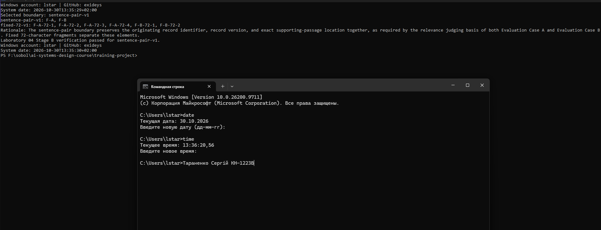
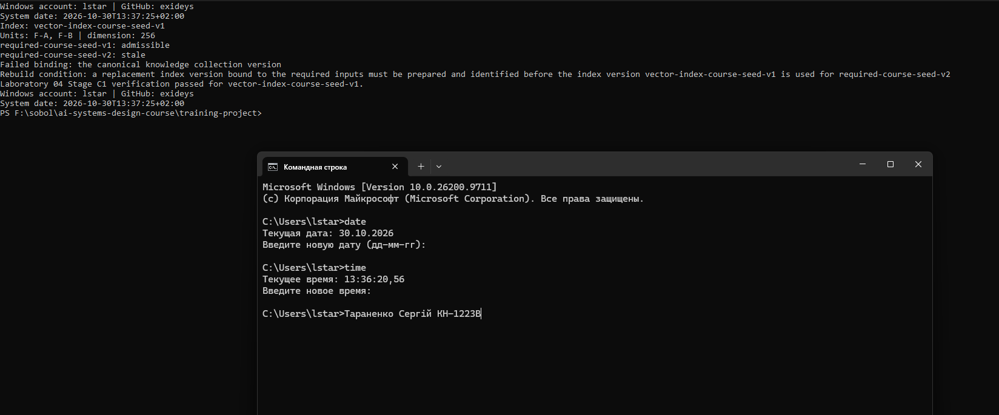
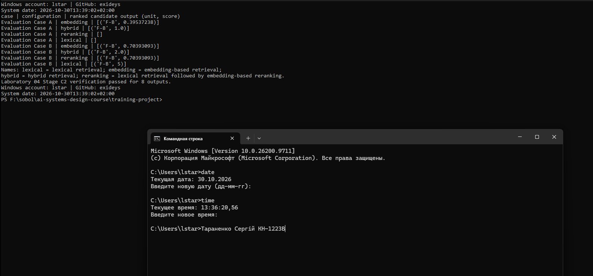
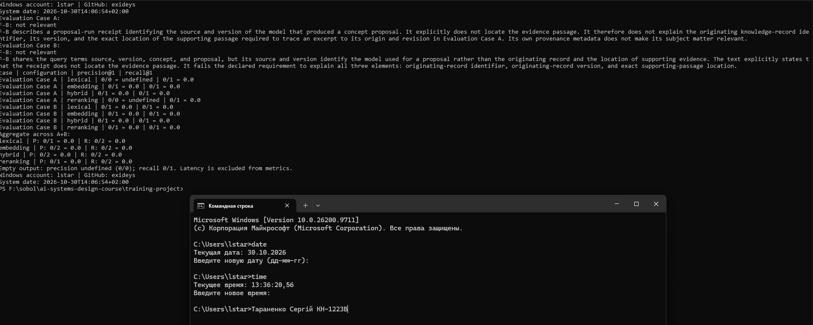
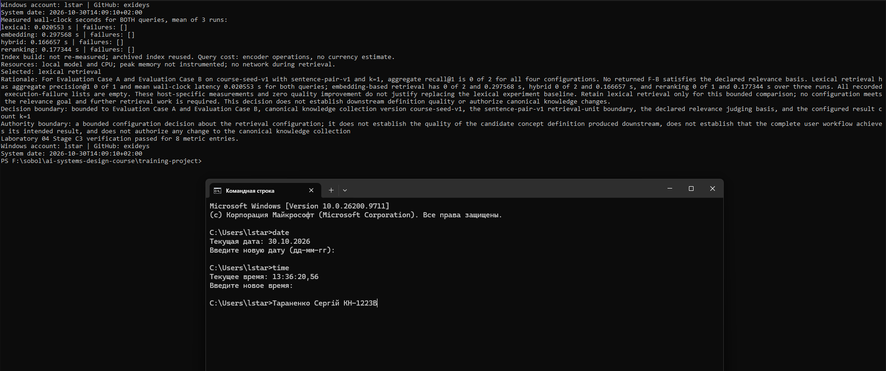

# Лабораторна робота 04. Ембединги та векторний пошук

## Ідентифікація

- Прізвище та ім’я студента: Taranenko Serhii.
- Група: KH-1223B.
- Ідентифікатор студента: `exideys`.
- Обліковий запис Windows: `lstar`.
- URL форка: https://github.com/exideys/ai-systems-design-course
- Особиста гілка: `lab04/exideys`
- Статус завершення: `complete`

Обчислення виконано локально 30 жовтня 2026 року. Гілку створено від `lab03/exideys`, після чого злито оновлення `upstream/main` для доступності команд перевірки звіту. Публікація на GitHub не виконувалася.

Судження, рішення та текст підготовлено за допомогою Codex. У машинному записі оцінювача прямо зазначено допомогу ШІ та необхідність перегляду студентом. Ці судження не є незалежною людською оцінкою без допомоги ШІ.

Студент переглянув підготовлені за допомогою Codex судження та рішення; п’ять початкових знімків збережено, повторний запуск публічних тестів успішний. Остаточний статус і повний хеш локального коміту фіксуються окремо командою verify після коміту.

Повний хеш остаточного коміту та результат перевірки належать до окремого `verification-report.json`. Хеш не вписується до вихідного звіту, оскільки редагування звіту після коміту змінює перевірювані свідчення.

## Мета роботи

Отримати відтворювані свідчення, достатні для рішення, чи доцільно замінити лексичну базову конфігурацію пошуком на основі ембедингів у двох оголошених випадках над колекцією `course-seed-v1`. Рішення має спиратися на збереження змісту одиниці пошуку, сумісність індексу, перевірені ранжування, релевантність, явну арифметику метрик та операційні вимірювання.

## Хід виконання

### Вибір межі одиниці інформаційного пошуку

Виконано `uv sync --extra lab04`, ініціалізовано каталог звіту та застосовано `prepare-boundaries`. Вихідні `R-A` і `R-B` належать до наданої курсом колекції `course-seed-v1`; для обох зафіксовано `student_generated: false` та `student_approved: false`. Студент не створював і не затверджував цих записів.

Контракт розрізняє текстовий запит, версію колекції, одиницю пошуку та її межу, конфігурацію, ранжований кандидатний вихід, очікуваний результат лише для оцінювача, підставу оцінювання, оцінювача та межу спостереження. Базова конфігурація — `lexical retrieval`; кандидатна — `embedding-based retrieval`. Очікуваний результат не входить до `operation_input`.

| Конфігурація межі | Результат для R-A | Результат для R-B | Перекриття |
| --- | --- | --- | --- |
| sentence-pair-v1: щонайбільше два речення | F-A, символи 1–215 | F-B, символи 1–143 | немає |
| fixed-72-v1: щонайбільше 72 символи з межею на пробілі | F-A-72-1–F-A-72-4 | F-B-72-1–F-B-72-2 | немає |

У `R-A` фіксовані фрагменти охоплюють діапазони 1–71, 73–140, 142–203 та 205–215. Розриви відповідають пробілам між фрагментами. Кожна одиниця містить стабільний ідентифікатор і зв’язок походження: ідентифікатор та версію канонічного запису, ідентифікатор та версію джерела, діапазон символів з індексацією від одиниці. Для `F-A` це `R-A`, 1, `course-source-a`, 1, 1–215; для `F-B` — `R-B`, 1, `course-source-b`, 1, 1–143.

Обрано `sentence-pair-v1`: текст `F-A` пояснює разом ідентифікатор первинного запису, версію запису й точне місце підтвердного уривка. Жоден окремий 72-символьний фрагмент не зберігає повної сукупності без реконструкції. Усі фрагменти класифіковано як `derived retrieval-side artifact; not a canonical knowledge collection member`.

Вибір зафіксовано через `record-boundary-decision`. Команда `verify-stage-b` успішно перевірила `sentence-pair-v1`. Перевірена відповідність межі критерію дозволила перейти до ембедингів. Машинні свідчення: `stage-b/boundary-comparison.json` та `stage-b/boundary-decision.yaml`.

Рисунок — `01-boundary-selection.png`.

### Ембединги та векторний індекс

Команда `fetch-embedding-model` завантажила `minishlab/potion-base-8M` ревізії `bf8b056651a2c21b8d2565580b8569da283cab23`. Походження зафіксовано в `models/potion-base-8M/model-provenance.json`. Команда `prepare-embeddings` створила по одному вектору для `F-A` та `F-B`; кожен має 256 скінченних координат.

Версія представлення — `course-static-embed-v1`. Простір — `potion-base-8M@bf8b056651a2c21b8d2565580b8569da283cab23/course-static-embed-v1`. Вектори, ідентифікатори та зв’язки походження містяться в `stage-c1/retrieval-unit-embeddings.json`.

Команда `prepare-index` підготувала `vector-index-course-seed-v1`, прив’язаний до `course-seed-v1`, `sentence-pair-v1`, оголошених моделі, ревізії, представлення, розмірності та простору. Файл `stage-c1/index-manifest.json` включає обидві одиниці та походження кожної. Стан індексу складається з векторів і асоціацій маніфесту; один маніфест не містить усього індексу.

| Потрібна конфігурація | Результат | Пояснення |
| --- | --- | --- |
| required-course-seed-v1 | admissible | потрібні прив’язки збігаються |
| required-course-seed-v2 | stale | потрібна колекція v2, зафіксована v1 |

Невдала прив’язка — `the canonical knowledge collection version`. Перед використанням для v2 потрібен інший підготовлений індекс із сумісними входами та окремою версією. Перевірка лише класифікувала індекс і не перебудовувала його. Результати містяться в `stage-c1/binding-check-required-course-seed-v1.json` та `stage-c1/binding-check-required-course-seed-v2.json`.

Команда `verify-stage-c1` успішно перевірила `vector-index-course-seed-v1`. До виконання запитів допущено v1; застарілий індекс для v2 не використовувався. Індекс є похідним станом пошуку, його підготовка не змінює канонічної колекції.

Рисунок — `02-embedding-index.png`.

### Порівняння конфігурацій інформаційного пошуку

Виконано два запити за всіма чотирма конфігураціями. Case A: `How can an auditor trace an excerpt to its origin and revision?` Case B: `Which source and version identify the supporting passage for a concept proposal?` Обидва випадки є розробницькими та не становлять незалежної перевірки узагальнення.

Установлено `k=1`; для переранжування беруться щонайбільше дві лексичні одиниці. Лексичний механізм підраховує відмінні точні спільні змістові слова після нормалізації та виключення службових слів. Ембедингова конфігурація виконує точний косинусний пошук. Гібридна додає нормалізовані бали незалежних ранжувань. Переранжування обмежене лексичним набором і не відновлює відсутню в ньому одиницю.

| Випадок | Конфігурація | Ранжований вихід | Бал |
| --- | --- | --- | --- |
| A | lexical retrieval | порожній | — |
| A | embedding-based retrieval | F-B | 0.3953723830 |
| A | hybrid retrieval | F-B | 1.0 |
| A | lexical retrieval followed by embedding-based reranking | порожній | — |
| B | lexical retrieval | F-B | 5 |
| B | embedding-based retrieval | F-B | 0.7039309338 |
| B | hybrid retrieval | F-B | 2.0 |
| B | lexical retrieval followed by embedding-based reranking | F-B | 0.7039309338 |

Кожен повернений `F-B` має ранг 1 і походження `R-B` / 1 / `course-source-b` / 1 / 1–143. Точні бали та докази ранжування містяться у восьми JSON-файлах `stage-c2/`. Бал сам по собі не є релевантністю; шкали різних механізмів також різні.

Порожній вихід `[]` лексичного пошуку в A означає відсутність спільних змістових слів. Порожнє переранжування успадковує порожній набір кандидатів. Обидві операції успішні; це не відмова виконання. Випадок B демонструє лексичний хибнопозитивний результат: збіг слів у квитанції запуску не задовольняє змістової потреби.

Команда `verify-stage-c2` успішно та незалежно відтворила всі вісім ранжувань. Це дозволило перейти до оцінювання архівованих результатів без передачі очікуваного результату операції пошуку. Спостереження не встановлюють загальної переваги жодного механізму.

Рисунок — `03-retrieval-comparison.png`.

### Судження про релевантність і метрики

Підстава однакова для обох випадків: одиниця має пояснювати, які дані ідентифікують первинний запис, його версію та точне місце підтвердного уривка. Множина унікальних повернених одиниць у кожному випадку дорівнює `{F-B}`. Підготовлено рівно одне судження для `F-B` у кожному випадку; для неповерненого `F-A` судження не додавалося.

| Випадок | Одиниця | Судження | Застосування критерію |
| --- | --- | --- | --- |
| A | F-B | not relevant | Квитанція описує джерело та версію моделі, яка створила пропозицію. Вона прямо не визначає місця доказового уривка, отже не пояснює зв’язку з первинним записом, його версією та точним місцем. |
| B | F-B | not relevant | Спільні слова source, version, concept і proposal стосуються моделі та її запуску. Вони не ідентифікують потрібного запису й уривка; текст прямо заперечує локалізацію доказового фрагмента. |

Власні метадані походження `F-B` не роблять зміст квитанції відповіддю на запит. Повні обґрунтування містяться в `judgments-input.json` та `stage-c3/relevance-judgments.json`. Команда `record-relevance-judgments` зафіксувала чернетку, підготовлену Codex. Походження оцінок зберігається після їх перегляду студентом. Очікуваний результат лише для оцінювача використовується окремо та не передавався пошуку.

Команда `compute-retrieval-metrics` повторно перевірила ранжування та створила `stage-c3/retrieval-metrics.json`. У таблиці P — кількість релевантних повернень / кількість повернень; R — кількість знайдених розглянутих релевантних одиниць / загальна кількість розглянутих релевантних. Очікуваний `F-A` дає знаменник recall 1 для кожного випадку.

| Випадок | Конфігурація | precision@1 | recall@1 |
| --- | --- | --- | --- |
| A | lexical retrieval | 0/0 = undefined | 0/1 = 0.00 |
| A | embedding-based retrieval | 0/1 = 0.00 | 0/1 = 0.00 |
| A | hybrid retrieval | 0/1 = 0.00 | 0/1 = 0.00 |
| A | lexical retrieval followed by embedding-based reranking | 0/0 = undefined | 0/1 = 0.00 |
| B | lexical retrieval | 0/1 = 0.00 | 0/1 = 0.00 |
| B | embedding-based retrieval | 0/1 = 0.00 | 0/1 = 0.00 |
| B | hybrid retrieval | 0/1 = 0.00 | 0/1 = 0.00 |
| B | lexical retrieval followed by embedding-based reranking | 0/1 = 0.00 | 0/1 = 0.00 |

| Конфігурація | Агрегована precision@1 | Агрегована recall@1 |
| --- | --- | --- |
| lexical retrieval | 0/1 = 0.00 | 0/2 = 0.00 |
| embedding-based retrieval | 0/2 = 0.00 | 0/2 = 0.00 |
| hybrid retrieval | 0/2 = 0.00 | 0/2 = 0.00 |
| lexical retrieval followed by embedding-based reranking | 0/1 = 0.00 | 0/2 = 0.00 |

Для порожнього виходу precision невизначена через 0/0; запис 0.00 помилково означав би наявність оціненого повернення. Recall залишається 0/1, оскільки очікувана одиниця існує незалежно від виходу. Агрегація підсумовує чисельники та знаменники: порожній вихід не збільшує знаменника precision, але очікуваний `F-A` входить до знаменника recall. Повне покриття повернень судженнями та перевірена арифметика дозволили перейти до операційного порівняння.

Рисунок — `04-relevance-metrics.png`.

### Операційні свідчення та обмежене рішення

Команда `measure-operational-evidence --runs 3` повторила обидва запити в тимчасових копіях свідчень. Вихідні ранжування не перезаписувалися. Час — середнє для обох запитів разом за три запуски в одному процесі; це не затримка окремого запиту та не час початкового завантаження моделі.

| Конфігурація | Середній час двох запитів, с | WorkflowError |
| --- | --- | --- |
| lexical retrieval | 0.020553 | 0 |
| embedding-based retrieval | 0.297568 | 0 |
| hybrid retrieval | 0.166657 | 0 |
| lexical retrieval followed by embedding-based reranking | 0.177344 | 0 |

П’ять операційних пунктів і межі їх тлумачення:

1. Побудова або оновлення індексу: повторно використано одну архівовану підготовку. Час і грошова вартість побудови не вимірювалися; перебудова не виконувалася.
2. Затримка: числові вимірювання наведено в таблиці. Вони стосуються цього хоста, двох запитів і трьох повторень та не доводять стабільного порядку швидкості на інших даних.
3. Вартість запиту: машинний файл описує її через кодування запиту та перевірочне кодування одиниць. Грошових вимірювань і фактичного лічильника викликів немає. Лексичний шлях не потребує ембедингу запиту; модельні шляхи перевіряють вектори двох одиниць і кодують запит.
4. Ресурси: локальна модель використовується в одному процесі; пошук виконується на CPU без мережевих запитів. Пікову пам’ять і числовий обсяг споживання не інструментовано.
5. Відмови: списки `execution failures` порожні. Облік охоплює підняті `WorkflowError` у вимірюваних запусках, без висновку про всі інші типи відмов.

Межі відповідають `stage-c3/operational-evidence.json`. Якісні описи пунктів 1, 3 і 4 не подаються як числові вимірювання. Жоден операційний показник не входить до чисельників або знаменників precision чи recall.

У `stage-c3/configuration-decision.json` збережено `lexical retrieval` як базову конфігурацію. У всіх конфігурацій recall дорівнює 0/2. Ембединги не дали виграшу в релевантності; базова конфігурація мала найменший час — 0.020553 с проти 0.297568 с у кандидатної. Заміна не обґрунтована. Збереження базової конфігурації не означає задоволення потреби пошуку: релевантного фрагмента не повернуто жодною конфігурацією.

Межа рішення: Evaluation Case A і B, `course-seed-v1`, `sentence-pair-v1`, оголошена підстава релевантності та `k=1`. Рішення не встановлює якості подальшого визначення поняття, успішності повного користувацького процесу та не дозволяє змін канонічної колекції. Свідчень достатньо для цього обмеженого рішення; для ширших висновків потрібні інші випадки й окреме оцінювання.

Рисунок — `05-operational-decision.png`.

### Остаточна перевірка

Команда `verify-stage-c3` успішно перевірила всі вісім записів метрик. Вона незалежно переобчислила арифметику з оцінок та перевірених восьми ранжувань. Верифікатор не формував власних суджень про релевантність.

Початковий `uv run python -m unittest discover -s tests/public -v` виконав 254 тести: 22 помилки, 3 пропуски. Усі 22 помилки виникли під час створення символічних посилань: Windows повернула `WinError 1314` через відсутність привілею. Повний вивід збережено в `public-tests.log`. Цей запуск не є успішним. Повторна перевірка потрібна в PowerShell із правом створення символічних посилань; результат і журнал зберігає `lab04_checkpoint.py tests`.

Для знімків `lab04_checkpoint.py` читає фактичні свідчення, показує обліковий запис і системну дату та виконує відповідні перевірки. Після перших п’яти знімків, перегляду оцінок та успішних публічних тестів дія `finalize` оновлює статус звіту й перевіряє його структуру.

Завершені свідчення фіксуються локальним комітом. Команда `verify --final-commit` перевіряє точний HEAD, структуру звіту, наявність свідчень та незмінність зафіксованих файлів. Вона доповнює доменну перевірку, але не замінює її. Остаточний результат визначається `outcome` у `verification-report.json`; успішний результат і той самий коміт мають бути видимі на шостому знімку.

Після остаточного коміту формуються лише `verification-report.json`, `screenshots/06-final-verification.png` та `submission/REPORT.md`. Команда `prepare-report` вбудовує всі шість зображень у Markdown для Teams. Зафіксовані свідчення після перевірки не редагуються. За вказівкою користувача відправлення на GitHub не виконується; форк не міститиме локальних результатів до окремо дозволеної публікації.

Рисунок — `06-final-verification.png`.

## Висновки

Межа `sentence-pair-v1` зберегла зміст для критерію релевантності. Підготовлено два 256-вимірні ембединги та індекс; сумісність підтверджено для v1, застарілість — для v2. Перевірено вісім реальних ранжувань. У кожному випадку єдиною поверненою одиницею була нерелевантна `F-B`, а лексичний пошук і переранжування в A повернули порожній результат.

Для всіх конфігурацій агреговані precision@1 та recall@1 дорівнюють нулю; для двох порожніх виходів precision окремого випадку — `undefined`. Операційні свідчення та відсутність виграшу в релевантності підтримують збереження лексичної базової конфігурації у цьому експерименті. Результати не встановлюють загальної переваги лексичного пошуку та не підтверджують придатності жодної конфігурації для ширшого використання.

Мету роботи досягнуто повністю в оголошеній межі порівняння: свідчення дозволяють відхилити заміну базової конфігурації. Нульова повнота пошуку вимагає подальшої роботи над якістю; збереження базової конфігурації не означає придатності для виробничого використання.
